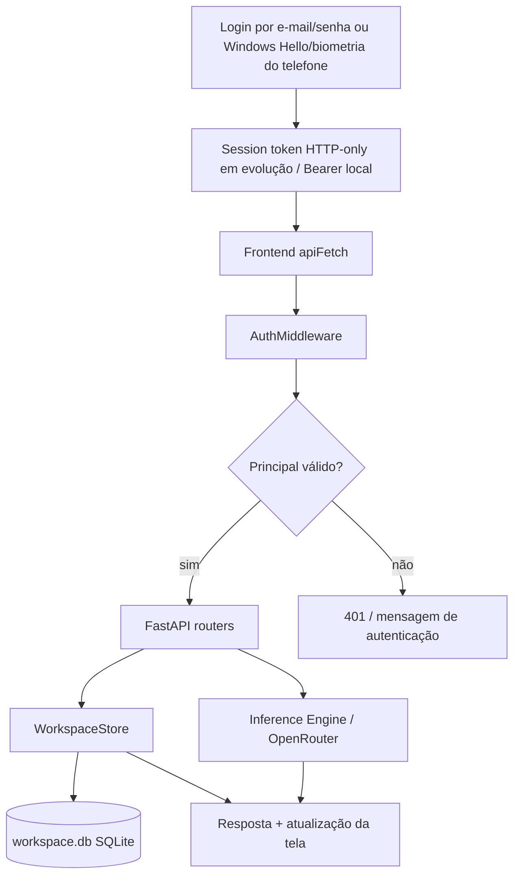

# Fluxo do backend local do JARVIS

O backend local foi organizado para que as telas não dependam mais apenas de
`localStorage`. O SQLite é o primeiro adaptador; a intenção é substituir o
adaptador por Neon/Postgres mantendo os contratos HTTP.

## Separação de credenciais

- Chaves de provedor (`OPENROUTER_API_KEY`, OpenAI, Anthropic etc.) são
  credenciais usadas pelo JARVIS para chamar modelos. Elas não autorizam
  sistemas externos a chamar o JARVIS.
- Chaves de aplicação (`oj_app_...`) são criadas na tela **API**, armazenadas
  somente como hash no SQLite e exibidas uma única vez. Elas autorizam um
  sistema externo a consumir a API conforme os escopos da chave.
- A biometria não é enviada ao servidor. Windows Hello, Android biometrics,
  Face ID e Touch ID participam de um fluxo WebAuthn/passkey; o servidor
  valida o desafio e guarda apenas a credencial pública.

## Contratos de workspace

As telas de projetos, conversas, tarefas, Conclave, notificações e
preferências usam os recursos abaixo:

| Tela | Rotas | Persistência |
| --- | --- | --- |
| Projetos | `/api/workspace/projects` | projetos e contagem de conversas |
| Chat | `/api/workspace/conversations` e `/messages` | conversas, fixação e mensagens |
| Tarefas | `/api/workspace/tasks` | status, prioridade, prazo e vínculo |
| Conclave | `/api/workspace/conclaves` | sessão, objetivo, agentes e decisão |
| Notificações | `/api/workspace/notifications` | leitura e histórico |
| Configurações/memória | `/api/workspace/settings` | preferências por usuário |

O dono (`user_id`) é aplicado em todas as consultas. Um usuário não consegue
ler ou alterar o projeto, conversa ou tarefa de outro usuário apenas trocando
o ID na URL.

## Migração futura para Neon

1. Manter os nomes e tipos lógicos das tabelas.
2. Criar migração Postgres forward-only para `auth_*` e `workspace_*`.
3. Substituir `WorkspaceStore`/`AuthStore` por repositórios Postgres.
4. Rodar validação de ownership, login, passkey, chat, projetos e tarefas
   antes do cutover.

Até essa etapa, a prova de funcionamento é local e não representa uma
conexão com Neon ou uma autenticação biométrica real no dispositivo.
